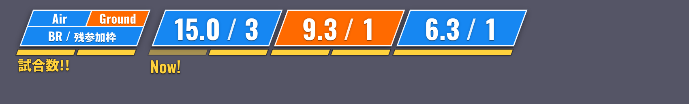
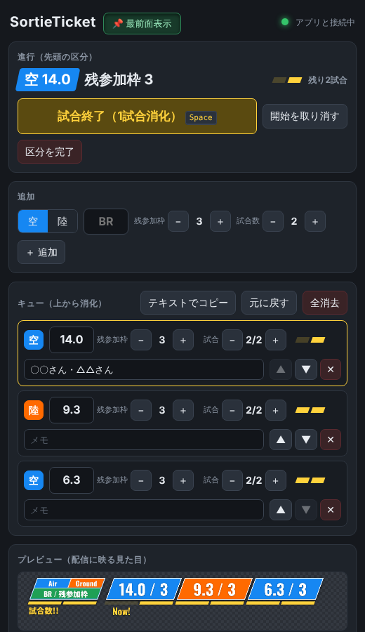
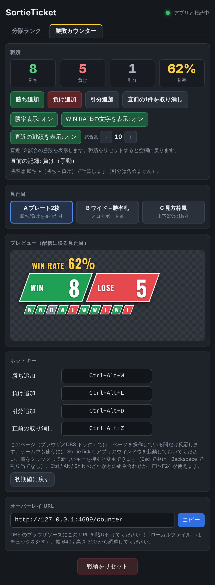
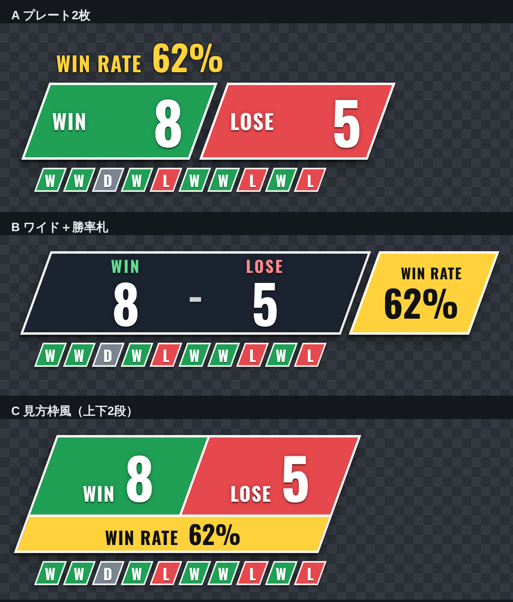
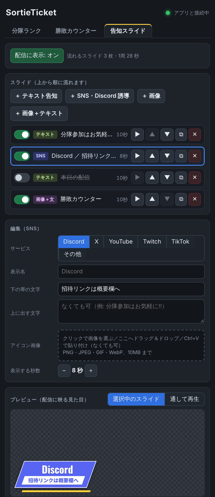
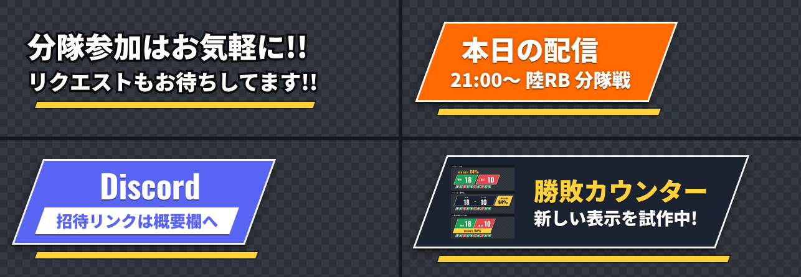
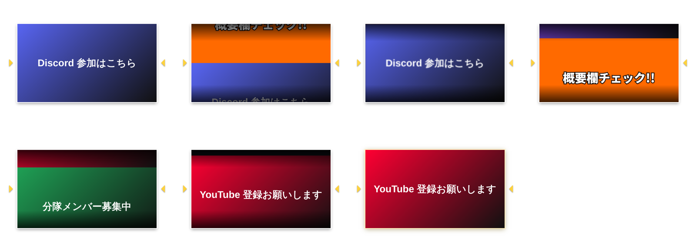
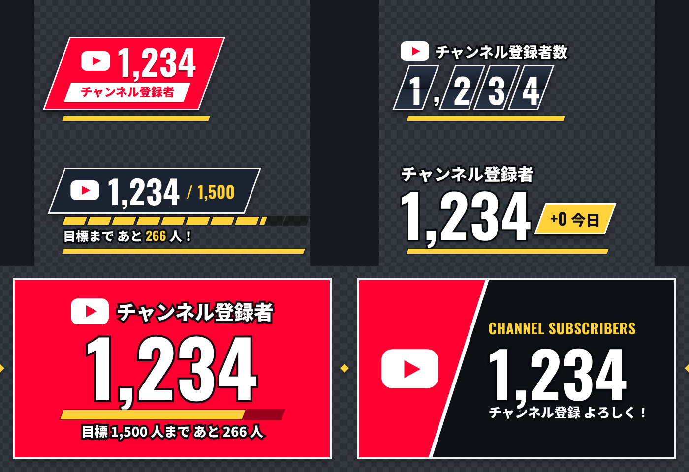

# SortieTicket（WT_SortieTicket）

War Thunder の分隊配信向けに、リスナーから受け付けた「行くランク」を OBS にアニメーション付きで表示する Windows アプリです。
受け付けた区分（空/陸・BR・残参加枠・試合数）を整理券のように並べ、左から順に消化していきます。



- アプリを起動して、表示される URL を OBS のブラウザソースに貼るだけで使えます（OBS 側の追加設定は不要）
- キューの追加・試合の進行・残参加枠の増減を、ボタンかキーボードで手早く操作できます
- 「勝敗カウンター」タブで勝ち/負け/引分を数え、勝率と直近の戦績を別の URL で OBS に表示できます（ゲーム中もホットキーで操作可能）
- 「告知スライド」タブで、テキスト告知・SNS/Discord 誘導・画像などをスライドショーにして別の URL で OBS に流せます
- 「スロット告知」タブで、16:9 のスライドをスロットのリールのように回し、確率を決めたランダムな 1 枚に止められます
- YouTube の登録者数を、告知スライド・スロット告知のスライドとして表示できます（YouTube Studio の画面から自動で読み取り。API キー不要）
- 背景は透過。区分が終わると上へ抜けて左に詰まるアニメーション付き

---

## 目次

- [ダウンロード](#ダウンロード)
- [はじめての設定](#はじめての設定)
- [配信に映る表示の見方](#配信に映る表示の見方)
- [操作画面](#操作画面)
- [キーボードショートカット](#キーボードショートカット)
- [勝敗カウンター](#勝敗カウンター)
- [告知スライド](#告知スライド)
- [スロット告知](#スロット告知)
- [登録者カウンター](#登録者カウンター)
- [設定と保存場所](#設定と保存場所)
- [困ったとき](#困ったとき)
- [開発者向け](#開発者向け)

---

## ダウンロード

ポータブル版（インストール不要の exe 1 つ）を配布しています。

- **リリース版**: [Releases](https://github.com/babuchandayo/WT_SortieTicket/releases) から `SortieTicket-<バージョン>-portable.exe` をダウンロード
- **開発中の最新版**: [Actions](https://github.com/babuchandayo/WT_SortieTicket/actions) の各ビルド結果ページ下部「Artifacts」の `SortieTicket-windows`（GitHub へのログインが必要。zip を展開すると exe が入っています）

好きなフォルダに置いてダブルクリックで起動します。

> 署名をしていないため、初回起動時に Windows の警告（SmartScreen）が出ることがあります。
> 「詳細情報」→「実行」で起動できます。

## はじめての設定

1. `SortieTicket` を起動すると操作画面が開きます。
2. 操作画面の一番下にある **オーバーレイ URL**（既定は `http://127.0.0.1:4630/`）の「コピー」を押します。
3. OBS で「ソース」→「＋」→「ブラウザ」を追加し、次のように設定します。

   | 項目 | 値 |
   |---|---|
   | ローカルファイル | **チェックを外す** |
   | URL | コピーした URL を貼り付け |
   | 幅 / 高さ | 1700 / 260 から始めて、配置に合わせて調整 |
   | カスタム CSS | そのままで OK（背景は最初から透過） |

4. 操作画面でキューを追加すると、OBS 側にも表示されます。

アプリを OBS より後に起動しても、オーバーレイは自動で再接続します。

## 配信に映る表示の見方

| 要素 | 意味 |
|---|---|
| 青のプレート | 空（Air） |
| オレンジのプレート | 陸（Ground） |
| `15.0 / 3` | BR / 残参加枠（配信者を除いてあと何人入れるか。0〜3） |
| 黄色ゲージ | 残り試合数（既定 2）。試合が終わるごとに左から消え、試合中のバーは点滅 |
| `Now!` | 今の区分。今の試合のゲージの真下に表示され、試合が進むと次のバーへ移動 |
| 左端の「見方」枠 | 凡例（Air / Ground、BR / 残参加枠、試合数!!）。「残参加枠」「試合数!!」は 10 秒ごとに英語（Open Slots / Battles!!）と交互に切り替わります。表示設定でオン/オフ |

区分の試合がすべて終わると、その区分は上へスライドして消え、残りが左に詰まります。
残参加枠が 0 の区分は数字が薄く表示されます。

## 操作画面



上から次の順に並んでいます。

### 進行（先頭の区分）

今消化中の区分です。

- 先頭の区分の「今の試合」のバーは常に点滅します。**試合終了（1 試合消化）** を押すとバーが 1 つ消えます。
- 最後の試合が終わると、その区分は自動でキューから外れ、次の区分が先頭になります。
- 押し間違えたときは「元に戻す」（`Ctrl` + `Z`）で戻せます。
- **区分を完了**: 試合数が残っていても、その区分を終わらせます。

### 追加

空/陸を選び、BR を入力して Enter（または「＋ 追加」）。
残参加枠と試合数は横の −/＋ で決めます（初期値は「表示設定」で変更できます）。
メモ欄に書いた内容は、追加した区分のメモとしてキューに入ります（空欄でも追加できます）。

### キュー（上から消化）

追加した区分の一覧です。一番上が今の区分で、配信では一番左に表示されます。

- BR・空/陸（色付きのボタン）・残参加枠・試合数をその場で変更できます。
- ▲▼で順番を入れ替えます。動かした区分は一瞬光ります。✕で削除。
- **メモ欄**: 参加者の名前などを書いておけます。操作画面だけに表示され、配信には映りません（60 文字まで）。
- **テキストでコピー**: `空14.0@2 -> 陸9.3@1` の形式でクリップボードにコピーします（配信タイトルなどに）。
- **元に戻す**: 直前の操作を取り消します（最大 50 回）。
- **全消去**: キューを空にします（元に戻すで復元できます）。

### プレビュー（配信に映る見た目）

OBS に映るのと同じ表示を縮小して確認できます。

### 表示設定

- **見方の枠を表示**: 左端の凡例のオン/オフ
- **試合数の初期値 / 残参加枠の初期値**: 「追加」で使う初期値

### オーバーレイ URL

OBS のブラウザソースに貼る URL と、そのコピーボタン。

### 最前面表示（アプリ名の右）

押している間（ボタンが沈んだ表示）は、操作画面が常に他のウィンドウより手前に表示されます。ゲーム画面の上に重ねて操作したいとき用。状態は次回起動時も引き継ぎます。

### ブラウザや OBS ドックから操作する

`http://127.0.0.1:4630/control` を普通のブラウザや OBS の「ドック」→「カスタムブラウザドック」で開いても同じ操作画面が使えます（アプリは起動しておく必要があります）。
複数の画面で開いても内容は同期します。最前面表示ボタンはアプリのウィンドウでだけ表示されます。

## キーボードショートカット

入力欄にカーソルがないときに使えます。

| キー | 動作 |
|---|---|
| `Space` | 試合終了（1 試合消化） |
| `Tab` / `Shift` + `Tab` | メモ欄だけを順に移動（「追加」のメモ → キューの上から順。入力中でも使えます） |
| `↑` / `↓` | 先頭区分の残参加枠を ＋1 / −1 |
| `Ctrl` + `Z` | 元に戻す |

入力欄では `Enter` で確定します（「追加」の BR 欄・メモ欄なら追加、キューのメモ欄なら保存）。

## 勝敗カウンター

操作画面上部のタブを「勝敗カウンター」に切り替えると使えます。分隊ランク表示とは別の URL で、OBS に勝敗・勝率・直近の戦績を表示します。



### OBS への設定

タブ内の **オーバーレイ URL**（既定は `http://127.0.0.1:4630/counter`）を、分隊ランクとは別のブラウザソースに貼ります。幅 640 / 高さ 300 から調整してください。背景は透過です。

### 操作

| ボタン | 動作 |
|---|---|
| 勝ち追加 / 負け追加 / 引分追加 | 1 試合分を記録 |
| 直前の1件を取り消し | 最後に記録した 1 件を消す。リセット直後に押すとリセット前に戻る |
| 勝率表示 | 勝率のオン/オフ |
| WIN RATEの文字を表示 | 勝率の横の「WIN RATE」の文字のオン/オフ |
| 直近の戦績を表示 | 直近 N 試合（既定 10、5〜20）の W/L/D の札のオン/オフ。古い順に左から並び、空きは点線の枠 |
| 戦績をリセット（最下部） | 戦績を空にする（確認あり） |

勝率は 勝ち ÷（勝ち＋負け）で、引分は含めません。記録がないときは `--%` と表示します。

### ホットキー（ゲーム中でも反応）

SortieTicket のウィンドウが前面になくても（最小化していても、ゲームをしていても）反応します。

| 既定のキー | 動作 |
|---|---|
| `Ctrl` + `Alt` + `W` | 勝ち追加 |
| `Ctrl` + `Alt` + `L` | 負け追加 |
| `Ctrl` + `Alt` + `D` | 引分追加 |
| `Ctrl` + `Alt` + `Z` | 直前の取り消し |

- タブ内の「ホットキー」欄をクリックして新しいキーを押すと変更できます（`Esc` で中止、`Backspace` で割り当てなし、「初期値に戻す」あり）。
- 使えるのは `Ctrl` / `Alt` / `Shift` との組み合わせ、または `F1`〜`F24` 単独です。
- 登録したキーは、SortieTicket の起動中は他のアプリでは使えなくなります。他のアプリがすでに使っているキーは登録できず、欄の右に「✕ 他のアプリが使用中」と出ます。その場合は別のキーにしてください。
- ブラウザや OBS ドックで操作画面を開いた場合は、そのページを操作している間だけ反応します。

### 見た目

「見た目」から 3 つの案を選べます。分隊ランク表示と同じ、斜めのプレート・白フチ・Oswald の数字で揃えています。



## 告知スライド

操作画面上部のタブを「告知スライド」に切り替えると使えます。配信内に個別に置いていた告知（テキスト・Discord 招待バナー・画像など）を 1 つのブラウザソースにまとめ、順番に切り替えて表示します。



### OBS への設定

タブ内の **オーバーレイ URL**（既定は `http://127.0.0.1:4630/promo`）を、別のブラウザソースに貼ります。幅 1000 / 高さ 450 から調整してください。背景は透過です。
スライドはブラウザソースの枠の中で「配置」で選んだ位置（既定は左下）に寄せて表示されます。

### テンプレート



| テンプレート | 入力する内容 |
|---|---|
| テキスト告知 | 見出し・本文（改行可）。見た目は「縁取り文字」（今の告知と同じ白い縁取り文字）か「プレート」（斜めの札）。色を選べます |
| SNS・Discord 誘導 | サービス（Discord / X / YouTube / Twitch / TikTok / その他）、表示名、下の帯の文字（例: 招待リンクは概要欄へ）、上に出す文字（なくても可）、アイコン画像（なくても可） |
| 画像 | 画像・大きさ・白フチの有無・下に出す文字（なくても可） |
| 画像＋テキスト | 画像（なくても可）・見出し・本文・プレートの色 |

SNS のロゴは同梱していません。ロゴを出したい場合は「アイコン画像」に画像を入れてください。

### 画像の入れ方

編集欄の点線の枠をクリックして選ぶ、枠へドラッグ＆ドロップ、またはタブを開いた状態で `Ctrl` + `V`（スクリーンショットなどクリップボードの画像を貼り付け）。
PNG・JPEG・GIF（アニメーションも可）・WebP、1 枚 10MB まで。画像は設定フォルダの `promo-images` に保存され、どのスライドからも使われなくなった画像は次回起動時に削除されます。

### 操作

| 操作 | 動作 |
|---|---|
| 配信に表示 | スライドショー全体のオン/オフ |
| ＋ テキスト告知 など | テンプレートからスライドを追加（例文入り） |
| 行のスイッチ | そのスライドを流すかどうか（オフにすると飛ばす） |
| ▶ | そのスライドを今すぐ配信に表示し、そこから順番に流す |
| ▲▼ / ⧉ / ✕ | 並べ替え / 複製 / 削除 |
| 表示する秒数 | スライドごとに 3〜300 秒（既定 10 秒） |
| プレビュー | 「選択中のスライド」だけ、または「通して再生」で確認 |

表示設定では、切り替え方（フェード / スライド / なし）、1 周したあとに隠す時間（なし〜60 分）、残り時間の黄色いバーのオン/オフ、全体の大きさ（30〜300%）、配置（9 か所）を選べます。
画像テンプレートで画像が未設定のスライドや、中身が空のスライドは自動で飛ばします（一覧に赤字で表示）。

## スロット告知

告知スライドの亜種です。16:9 のスライドを 1 本のリールに並べ、上から下へ回して、抽選で選ばれた 1 枚に止めます。



### OBS への設定

操作画面の「スロット告知」タブ一番下の URL（`http://127.0.0.1:4630/slot`）を、OBS のブラウザソースに貼ります（「ローカルファイル」はチェックを外す）。
幅 1920 / 高さ 1080（画面全体）にして、「スライドの幅」と「配置」で位置を合わせるのがおすすめです。背景は透過です。

### スライドと確率

- 「＋ スライドを追加」でスライドを作り、画像（16:9 推奨。違う比率は中央を切り抜いて表示）を入れます。クリック・ドラッグ＆ドロップ・Ctrl+V で入れられます。
- 画像がないスライドは、「名前」の文字を背景色の上に大きく表示します。
- 各スライドの **重み**（1〜100）の比で抽選します。一覧に「重みの比（%）」と「実際（同じものが連続しない条件で長く回したときの出現率の目安）」を表示します。
- **同じスライドは連続して出ません**（直前に出たものを除いて抽選）。そのため 2 枚だけだと必ず交互になり、1 枚だけだと毎回それに止まります。
- 左のスイッチで抽選から外せます。
- **リールに出す**: オフにしたスライドは、回っている間のリールには流れず、当たったときに初めて姿を見せます（隠し要素向け。抽選には入っています）。一覧に「隠し」と表示されます。

### 回し方

- **回す** ボタン、またはホットキー（既定 `Ctrl` + `Alt` + `S`。アプリのウィンドウならゲーム中も有効）で回します。
- **自動で回す**: 15 秒〜60 分ごとに自動で回します（既定はしない）。
- **回っている時間**: 2〜15 秒（既定 5 秒）。
- **止まったあと**: 「出したまま」（既定）か、指定した秒数だけ表示して隠す。
- 抽選はアプリ側で行うので、OBS とプレビューには同じ結果が出ます。回っている最中はもう一度回せません。

## 登録者カウンター

YouTube のチャンネル登録者数を、告知スライド・スロット告知のスライドとして表示します。



| 置き場所 | デザイン |
|---|---|
| 告知スライド（「＋ 登録者カウンター」） | A プレート / B ドラム（増えた桁が回って黄色になる） / C 目標ゲージ / D デカ文字（増加数つき） |
| スロット告知（スライドの「種類」を「登録者カウンター」に） | E YouTube の赤 / F 黒＋赤の斜め帯 |

数が増えると、数字が数え上がって「+1」が浮かびます。

### 登録者数の取り方

登録者カウンターのスライドを作ると、そのタブに「登録者数の取り方」の欄が出ます（告知スライドとスロット告知で共通）。

- **YouTube Studio から自動**（既定）: YouTube Studio の「現在の登録者数」のページをアプリが裏で開き、表示されている数を数秒ごとに読み取ります。API キーは使いません。
  1. ブラウザで YouTube Studio を開き、「アナリティクス」→「現在の登録者数」の詳細ページを開いて、そのアドレスをコピーします。
  2. 「Studio の URL」に貼り付けます。
  3. 「ログイン」を押し、開いたウィンドウで YouTube にログインします。登録者数のページが出たらウィンドウを閉じます。ログイン状態はアプリに保存されます。
- **手入力**: 入力した数をそのまま表示します。自動で読めないときの予備です。

**目標人数** を入れると、C・E に目標までのゲージと残り人数が出ます（0 で目標なし）。
**増加数**（D の「+12 今日」）は毎日 0 時に 0 に戻ります。「今から数え直す」を押すと、そこからの増加数になります。

注意:
- YouTube Studio の画面の作りが変わると読み取れなくなることがあります。そのときは状態欄にメッセージが出るので、手入力に切り替えてください。
- 数日でログアウトされることがあります。状態欄に「ログインが必要です」と出たら、もう一度「ログイン」してください。
- 自動の読み取りはアプリ（exe）の起動中だけ動きます。`npm run serve` やブラウザで開いた操作画面からは手入力だけ使えます。
- 数がまだ取れていないあいだ、告知スライドの登録者カウンターは飛ばされます（スロット告知では `----` と表示）。


キューと表示設定は自動で保存され、次回起動時にそのまま復元されます。
保存先はメニュー「ファイル」→「設定フォルダを開く」で開けます（通常は `%APPDATA%\SortieTicket`）。

| ファイル | 内容 |
|---|---|
| `state.json` | キュー・メモ・表示設定 |
| `counter.json` | 勝敗カウンターの戦績・表示設定・ホットキー |
| `promo.json` / `promo-images` | 告知スライドの内容・表示設定 / アップロードした画像（スロット告知の画像もここ） |
| `slot.json` | スロット告知のスライド・重み・表示設定・直前の結果 |
| `subs.json` | 登録者カウンターの取り方・Studio の URL・目標人数・最後に読めた数・増加数の基準 |
| `config.json` | ポート番号（`port`）、最前面表示（`alwaysOnTop`） |

## 困ったとき

**「ポート 4630 は他のアプリが使っています」と出て起動できない**
SortieTicket を二重に起動した場合は、このエラーは出ずに既存のウィンドウが前面に出ます。このエラーが出るときは、別のアプリが同じポートを使っています。
他のアプリと重なっている場合は、`config.json` の `port` を別の番号（例: `4640`）に書き換えてアプリを再起動し、OBS の URL も合わせて変更してください。

**OBS に何も表示されない**
- アプリが起動しているか確認してください。
- ブラウザソースの「ローカルファイル」のチェックが外れていて、URL が操作画面に表示されているものと同じか確認してください。
- キューが空のときは、見方の枠だけが表示されます（見方の枠もオフにしている場合は何も表示されません）。
- ブラウザソースのプロパティで「現在のページのキャッシュを更新」を押すと再読み込みされます。

**操作画面の右上が「アプリと通信できません」になっている**
ブラウザ・OBS ドックで開いている操作画面の場合、アプリが終了しています。アプリを起動すると自動で再接続します。

**表示が大きすぎる / 小さすぎる**
OBS 上でソースを拡大縮小してください。

---

## 開発者向け

### 必要なもの

- Node.js 22
- Windows 用 exe のビルドは Windows 上で行います（GitHub Actions で自動ビルドされます）

### コマンド

```sh
npm install
npm start          # Electron で起動
npm run serve      # Electron なしでサーバーだけ起動（ブラウザで http://127.0.0.1:4630/control を開いて確認）
npm test           # テスト
npm run dist       # Windows 用ポータブル版 exe を dist/ に作成
```

`npm start` / `serve` / `test` / `dist` の前に、必要なフォント（Oswald 700 / Noto Sans JP 900）だけが `src/public/fonts/` にコピーされます（`scripts/copy-fonts.js`）。オフラインでも表示が変わらないようにアプリに同梱しています。

### 仕組み

```
操作画面 (control.html) ──PUT /api/state──▶ ローカルサーバー (server.js) ──SSE /events──▶ オーバーレイ (overlay.html)
                         ◀──────SSE /events──┘        │                                      （OBS ブラウザソース）
                                                       └─ state.json に保存
```

- サーバーは `127.0.0.1` だけで待ち受けます。他の Web サイトからの書き換えは Origin と Content-Type の検査で拒否します。
- 状態は操作画面が丸ごと送り、サーバーが検査・補正（`src/state.js`）してから保存・配信します。
- オーバーレイは区分の id ごとに差分で描画し、追加・削除・並べ替えをアニメーションさせます。

### ファイル構成

| パス | 内容 |
|---|---|
| `src/main.js` | Electron。ローカルサーバーを起動し、操作画面のウィンドウを開く。最前面表示の切り替え |
| `src/preload.js` | 操作画面に最前面表示・ホットキー・YouTube ログインの操作だけを公開 |
| `src/server.js` | HTTP サーバー（画面の配信・状態の保存・SSE） |
| `src/state.js` | 状態の形と検査 |
| `src/promo.js` | 告知スライドの状態の形と検査、画像の種類判定 |
| `src/slot.js` | スロット告知の状態の形と検査、抽選 |
| `src/subs.js` | 登録者カウンターの状態の形と検査、読み取った文字の数値化 |
| `src/subs-reader.js` | YouTube Studio のページを裏で開いて登録者数を読む（Electron のみ） |
| `src/public/subs-view.js` / `subs-view.css` | 登録者カウンターの見た目（告知スライド・スロット告知で共通） |
| `src/public/promo.html` | 告知スライドのオーバーレイ |
| `src/public/overlay.html` | OBS に表示する画面。色やサイズは冒頭の `:root` の変数で調整 |
| `src/public/control.html` | 操作画面 |
| `scripts/copy-fonts.js` | 同梱フォントのコピー |
| `test/` | テスト（`node --test`） |
| `.github/workflows/build.yml` | テストと Windows ビルド |

### リリース

push と PR のたびに GitHub Actions がテストと Windows ビルドを行い、exe を Actions の成果物に置きます。
`package.json` の `version` を上げてから `v0.2.0` のようなタグを push すると、GitHub Releases にも exe が公開されます。

```sh
git tag v0.2.0
git push origin v0.2.0
```
