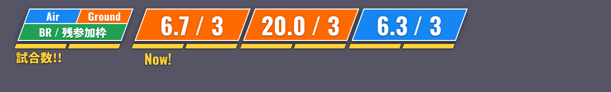

# WT_SortieTicket

WarThunder の分隊で行くランク（空/陸・BR・残参加枠・残り試合数）を、OBS にアニメーション付きで表示するアプリです。
受付した区分を左から順に消化していく「整理券」のような使い方を想定しています。



## 使い方

1. `SortieTicket` を起動すると操作画面が開きます。
2. 画面上部の「オーバーレイ URL」（既定は `http://127.0.0.1:4630/`）をコピーします。
3. OBS → ソースを追加 →「ブラウザ」→「ローカルファイル」のチェックを外し、URL に貼り付けます。
   幅 1700 / 高さ 260 くらいから調整してください。背景は最初から透過です。

操作画面は普通のブラウザや OBS の「カスタムブラウザドック」で `http://127.0.0.1:4630/control` を開いても使えます。
複数の画面で開いた場合も内容は同期します。

## 表示

| 要素 | 意味 |
|---|---|
| 青 / オレンジのプレート | 空 / 陸 |
| `15.0 / 3` | BR / 残参加枠 |
| 黄色ゲージ | 残り試合数（既定 2）。試合が終わるごとに左から消え、進行中は点滅 |
| `Now!` | 今の区分。今の試合のゲージの真下に表示 |
| 左端の「見方」枠 | 凡例。表示設定でオン/オフ |

区分の試合がすべて終わると、その区分は上へスライドして消え、残りが左に詰まります。

## 操作

- **追加**: 空/陸を選び、BR を入力して Enter（残参加枠・試合数は横の ± で調整）。
- **最前面表示**: アプリ名の右のボタンで、操作画面を常に他のウィンドウより前に表示（押している間はオン。次回起動時も引き継ぎ）。
- **Space**: 試合開始（ゲージ点滅）→ もう一度で試合終了（ゲージが 1 つ消える）
- **↑ / ↓**: 先頭区分の残参加枠 ±1
- **Esc**: 試合開始の取り消し
- **Ctrl+Z**: 元に戻す
- キュー一覧（上から消化）から BR・空/陸・残参加枠・試合数・順番（▲▼）・削除を直接変更できます。
- 区分ごとにメモを残せます（操作画面だけに表示され、配信には映りません）。
- 「テキストでコピー」で従来の `空14.0@2 -> 陸9.3@1` 形式をクリップボードへコピーします。

キューと設定はアプリのデータフォルダ（メニュー「ファイル → 設定フォルダを開く」）の `state.json` に保存され、次回起動時に復元されます。

## ポートの変更

設定フォルダの `config.json` の `port` を書き換えてアプリを再起動してください。

## 開発

```sh
npm install
npm start          # Electron で起動
npm run serve      # Electron なしでサーバーだけ起動（ブラウザで確認用）
npm test
npm run dist       # Windows 用のポータブル版 exe を dist/ に作成
```

GitHub Actions で push のたびに Windows 用 exe をビルドし、Actions の成果物に置きます。
`v0.1.0` のようなタグを push すると、GitHub Releases にも exe が公開されます。

構成:

- `src/main.js` … Electron。ローカルサーバーを起動し、操作画面のウィンドウを開く
- `src/preload.js` … 操作画面に最前面表示の切り替えだけを公開
- `src/server.js` … `127.0.0.1` だけで待ち受ける HTTP サーバー（オーバーレイ配信・状態の保存・SSE での配信）
- `src/state.js` … 状態の形と検査
- `src/public/overlay.html` … OBS に表示する画面
- `src/public/control.html` … 操作画面
