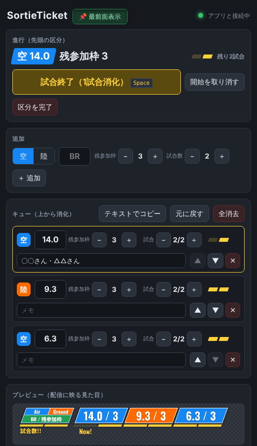

# SortieTicket（WT_SortieTicket）

War Thunder の分隊配信向けに、リスナーから受け付けた「行くランク」を OBS にアニメーション付きで表示する Windows アプリです。
受け付けた区分（空/陸・BR・残参加枠・試合数）を整理券のように並べ、左から順に消化していきます。


- アプリを起動して、表示される URL を OBS のブラウザソースに貼るだけで使えます（OBS 側の追加設定は不要）
- キューの追加・試合の進行・残参加枠の増減を、ボタンかキーボードで手早く操作できます
- 背景は透過。区分が終わると上へ抜けて左に詰まるアニメーション付き

---

## 目次

- [ダウンロード](#ダウンロード)
- [はじめての設定](#はじめての設定)
- [配信に映る表示の見方](#配信に映る表示の見方)
- [操作画面](#操作画面)
- [キーボードショートカット](#キーボードショートカット)
- [設定と保存場所](#設定と保存場所)
- [困ったとき](#困ったとき)
- [開発者向け](#開発者向け)

---

## ダウンロード

ポータブル版（インストール不要の exe 1 つ）を配布しています。

- **リリース版**: [Releases](https://github.com/babuchandayo/WT_SortieTicket/releases) から `SortieTicket-<バージョン>-portable.exe` をダウンロード
- **開発中の最新版**: [Actions](https://github.com/babuchandayo/WT_SortieTicket/actions) の各ビルド結果ページ下部「Artifacts」の `SortieTicket-windows`（GitHub へのログインが必要。zip を展開すると exe が入っています）

好きなフォルダに置いてダブルクリックで起動します。

> 署名をしていないため、初回起動時に Windows の警告（SmartScreen）が出ることがあります。
> 「詳細情報」→「実行」で起動できます。

## はじめての設定

1. `SortieTicket` を起動すると操作画面が開きます。
2. 操作画面の一番下にある **オーバーレイ URL**（既定は `http://127.0.0.1:4630/`）の「コピー」を押します。
3. OBS で「ソース」→「＋」→「ブラウザ」を追加し、次のように設定します。

   | 項目 | 値 |
   |---|---|
   | ローカルファイル | **チェックを外す** |
   | URL | コピーした URL を貼り付け |
   | 幅 / 高さ | 1700 / 260 から始めて、配置に合わせて調整 |
   | カスタム CSS | そのままで OK（背景は最初から透過） |

4. 操作画面でキューを追加すると、OBS 側にも表示されます。

アプリを OBS より後に起動しても、オーバーレイは自動で再接続します。

## 配信に映る表示の見方

| 要素 | 意味 |
|---|---|
| 青のプレート | 空（Air） |
| オレンジのプレート | 陸（Ground） |
| `15.0 / 3` | BR / 残参加枠（配信者を除いてあと何人入れるか。0〜3） |
| 黄色ゲージ | 残り試合数（既定 2）。試合が終わるごとに左から消え、試合中のバーは点滅 |
| `Now!` | 今の区分。今の試合のゲージの真下に表示され、試合が進むと次のバーへ移動 |
| 左端の「見方」枠 | 凡例（Air / Ground、BR / 残参加枠、試合数!!）。表示設定でオン/オフ |

区分の試合がすべて終わると、その区分は上へスライドして消え、残りが左に詰まります。
残参加枠が 0 の区分は数字が薄く表示されます。

## 操作画面



上から次の順に並んでいます。

### 進行（先頭の区分）

今消化中の区分です。

- **試合開始** → ゲージのバーが点滅します。もう一度押すと **試合終了（1 試合消化）** でバーが 1 つ消えます。
- 最後の試合が終わると、その区分は自動でキューから外れ、次の区分が先頭になります。
- **開始を取り消す**: 試合開始を押し間違えたとき用。
- **区分を完了**: 試合数が残っていても、その区分を終わらせます。

### 追加

空/陸を選び、BR を入力して Enter（または「＋ 追加」）。
残参加枠と試合数は横の −/＋ で決めます（初期値は「表示設定」で変更できます）。
メモ欄に書いた内容は、追加した区分のメモとしてキューに入ります（空欄でも追加できます）。

### キュー（上から消化）

追加した区分の一覧です。一番上が今の区分で、配信では一番左に表示されます。

- BR・空/陸（色付きのボタン）・残参加枠・試合数をその場で変更できます。
- ▲▼で順番を入れ替えます。動かした区分は一瞬光ります。✕で削除。
- **メモ欄**: 参加者の名前などを書いておけます。操作画面だけに表示され、配信には映りません（60 文字まで）。
- **テキストでコピー**: `空14.0@2 -> 陸9.3@1` の形式でクリップボードにコピーします（配信タイトルなどに）。
- **元に戻す**: 直前の操作を取り消します（最大 50 回）。
- **全消去**: キューを空にします（元に戻すで復元できます）。

### プレビュー（配信に映る見た目）

OBS に映るのと同じ表示を縮小して確認できます。

### 表示設定

- **見方の枠を表示**: 左端の凡例のオン/オフ
- **試合数の初期値 / 残参加枠の初期値**: 「追加」で使う初期値

### オーバーレイ URL

OBS のブラウザソースに貼る URL と、そのコピーボタン。

### 最前面表示（アプリ名の右）

押している間（ボタンが沈んだ表示）は、操作画面が常に他のウィンドウより手前に表示されます。ゲーム画面の上に重ねて操作したいとき用。状態は次回起動時も引き継ぎます。

### ブラウザや OBS ドックから操作する

`http://127.0.0.1:4630/control` を普通のブラウザや OBS の「ドック」→「カスタムブラウザドック」で開いても同じ操作画面が使えます（アプリは起動しておく必要があります）。
複数の画面で開いても内容は同期します。最前面表示ボタンはアプリのウィンドウでだけ表示されます。

## キーボードショートカット

入力欄にカーソルがないときに使えます。

| キー | 動作 |
|---|---|
| `Space` | 試合開始 → もう一度で試合終了（1 試合消化） |
| `Esc` | 試合開始の取り消し |
| `↑` / `↓` | 先頭区分の残参加枠を ＋1 / −1 |
| `Ctrl` + `Z` | 元に戻す |

入力欄では `Enter` で確定します（「追加」の BR 欄・メモ欄なら追加、キューのメモ欄なら保存）。

## 設定と保存場所

キューと表示設定は自動で保存され、次回起動時にそのまま復元されます。
保存先はメニュー「ファイル」→「設定フォルダを開く」で開けます（通常は `%APPDATA%\SortieTicket`）。

| ファイル | 内容 |
|---|---|
| `state.json` | キュー・メモ・表示設定 |
| `config.json` | ポート番号（`port`）、最前面表示（`alwaysOnTop`） |

## 困ったとき

**「ポート 4630 は他のアプリが使っています」と出て起動できない**
SortieTicket を二重に起動した場合は、このエラーは出ずに既存のウィンドウが前面に出ます。このエラーが出るときは、別のアプリが同じポートを使っています。
他のアプリと重なっている場合は、`config.json` の `port` を別の番号（例: `4640`）に書き換えてアプリを再起動し、OBS の URL も合わせて変更してください。

**OBS に何も表示されない**
- アプリが起動しているか確認してください。
- ブラウザソースの「ローカルファイル」のチェックが外れていて、URL が操作画面に表示されているものと同じか確認してください。
- キューが空のときは、見方の枠だけが表示されます（見方の枠もオフにしている場合は何も表示されません）。
- ブラウザソースのプロパティで「現在のページのキャッシュを更新」を押すと再読み込みされます。

**操作画面の右上が「アプリと通信できません」になっている**
ブラウザ・OBS ドックで開いている操作画面の場合、アプリが終了しています。アプリを起動すると自動で再接続します。

**表示が大きすぎる / 小さすぎる**
OBS 上でソースを拡大縮小してください。

---

## 開発者向け

### 必要なもの

- Node.js 22
- Windows 用 exe のビルドは Windows 上で行います（GitHub Actions で自動ビルドされます）

### コマンド

```sh
npm install
npm start          # Electron で起動
npm run serve      # Electron なしでサーバーだけ起動（ブラウザで http://127.0.0.1:4630/control を開いて確認）
npm test           # テスト
npm run dist       # Windows 用ポータブル版 exe を dist/ に作成
```

`npm start` / `serve` / `test` / `dist` の前に、必要なフォント（Oswald 700 / Noto Sans JP 900）だけが `src/public/fonts/` にコピーされます（`scripts/copy-fonts.js`）。オフラインでも表示が変わらないようにアプリに同梱しています。

### 仕組み

```
操作画面 (control.html) ──PUT /api/state──▶ ローカルサーバー (server.js) ──SSE /events──▶ オーバーレイ (overlay.html)
                         ◀──────SSE /events──┘        │                                      （OBS ブラウザソース）
                                                       └─ state.json に保存
```

- サーバーは `127.0.0.1` だけで待ち受けます。他の Web サイトからの書き換えは Origin と Content-Type の検査で拒否します。
- 状態は操作画面が丸ごと送り、サーバーが検査・補正（`src/state.js`）してから保存・配信します。
- オーバーレイは区分の id ごとに差分で描画し、追加・削除・並べ替えをアニメーションさせます。

### ファイル構成

| パス | 内容 |
|---|---|
| `src/main.js` | Electron。ローカルサーバーを起動し、操作画面のウィンドウを開く。最前面表示の切り替え |
| `src/preload.js` | 操作画面に最前面表示の切り替えだけを公開 |
| `src/server.js` | HTTP サーバー（画面の配信・状態の保存・SSE） |
| `src/state.js` | 状態の形と検査 |
| `src/public/overlay.html` | OBS に表示する画面。色やサイズは冒頭の `:root` の変数で調整 |
| `src/public/control.html` | 操作画面 |
| `scripts/copy-fonts.js` | 同梱フォントのコピー |
| `test/` | テスト（`node --test`） |
| `.github/workflows/build.yml` | テストと Windows ビルド |

### リリース

push と PR のたびに GitHub Actions がテストと Windows ビルドを行い、exe を Actions の成果物に置きます。
`package.json` の `version` を上げてから `v0.2.0` のようなタグを push すると、GitHub Releases にも exe が公開されます。

```sh
git tag v0.2.0
git push origin v0.2.0
```
